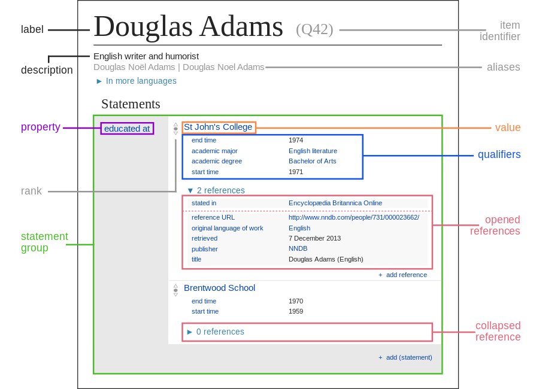

# Technology

A **knowledge graph** represents a network of real-world entities—such as objects, events, situations, or concepts—and the relationships among them.\
Rather than storing facts in isolated tables, it connects them as a web of meaning.

Most organisations operate multiple information systems that are only partially integrated. Data is scattered across different applications, servers, or even departments—often in incompatible formats. Because of this fragmentation, information cannot easily be viewed or analysed as a whole.

Over the past decades, attempts to unify such systems through **centralised databases** or **data lakes** have often fallen short. These solutions are expensive, complex to maintain, and quickly become outdated. By the time a central database is complete, the organisation’s needs and the way it structures knowledge have usually changed.

Here’s where **knowledge graphs** offer a better alternative. They can **connect and harmonise diverse, initially unrelated data sources** without forcing them into a single rigid schema. The graph structure allows information to grow and evolve dynamically.

An analogy helps here:\
\> A traditional database is like a filing cabinet—everything has its drawer, but adding new categories can be hard, and if you have big filing cabinet without a map, it is very difficult to find just the right thing that you are looking for. \> A knowledge graph is more like a map—it connects places (entities) through roads (relationships), and you can always add new routes as you discover new links. You can stick post-its to the drawers to know what is inside them.

In practice, knowledge graphs can power integrated insights such as *Customer 360* in business environments or *Collection 360* in museums—providing a complete, interconnected view of data from many origins.

They are also an ideal tool for implementing the **Human-in-the-Loop (HITL)** design principle in AI systems. By providing a transparent structure of how data points connect, knowledge graphs let human experts inspect, validate, and correct what the AI learns—making automated reasoning both auditable and trustworthy.

## Wikibase

**Wikibase** is the software platform that powers **Wikidata**, a collaboratively edited, multilingual knowledge graph maintained by the Wikimedia Foundation. Wikidata serves as a shared open database that anyone—Wikimedia projects such as Wikipedia, or external organisations—can reuse freely under the [CC0](https://creativecommons.org/public-domain/cc0/) public domain license.

As of early 2023, Wikidata contained more than *1.5 billion verifiable statements* about the world. Each statement is a small, structured fact—for example:

> *Douglas Adams — date of birth — 11 March 1952.*

Wikidata is a [document-oriented database](https://en.wikipedia.org/wiki/Document-oriented_database), focusing on **items** that represent topics, concepts, or tangible objects. Each item acts as a document that stores facts and their connections to other items.

{fig-align="center"}

\`\`\`{=html} <!---

**Optional visual additions (recommended):**

1. 📊 *Add a small schematic figure* showing the difference between:
   - a **relational table** (rows and columns) and  
   - a **graph** (nodes and edges labelled “composer”, “work”, “recording”).  
   → This helps non-technical readers instantly grasp the concept of relationships.

2. 🧠 *Add a “human-in-the-loop” diagram*: a circular feedback loop showing “Data → AI Model → Expert Review → Improved Data”.  
   → This makes the HITL concept visually intuitive and links it to your FAIR/8-star framework.

--->
